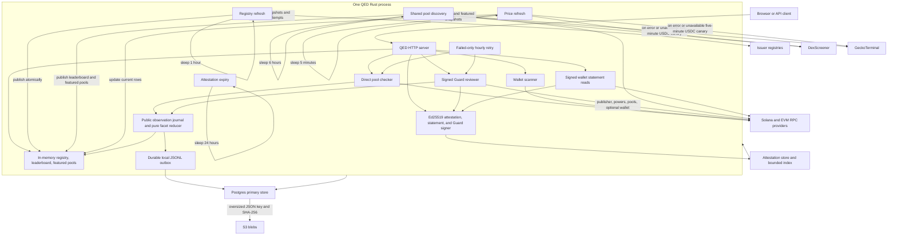
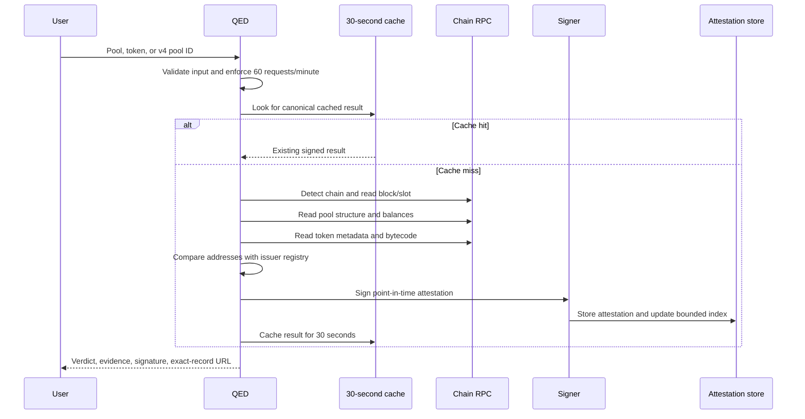

# Runtime architecture

QED checks tokens that claim to be something against the contract their issuer publishes. QED is one Rust process. It serves the website and API, refreshes public pool data, performs direct chain reads, and signs point-in-time attestations. It is read-only with respect to supported chains and never submits transactions.

## Process and background work

Ordinary page and API reads use prepared in-memory snapshots. They do not trigger pool discovery or blockchain reads unless the route explicitly performs a check, Guard review, wallet scan, token-power observation, signed wallet statement, re-check, or verification operation. Token pages wait up to 2.5 seconds for concurrent token-power observations, then render completed cached results and mark unresolved observations unavailable while deduplicated background reads continue. Signed wallet-statement creation is independently bounded to 15 seconds; its EVM block selector is exact, while Solana uses `minContextSlot` and records the returned slot rather than claiming an exact historical snapshot.

The powers warm pass is low priority and reports `warmed=false` when there are no targets, so an empty startup pass does not suppress later discovery-triggered work. It orders leaderboard tickers by reported 24-hour volume, with featured-only tickers following, and admits whole ticker groups up to 160 contracts. The top 25 registry tickers are considered on each 6-hour pass and after registry/discovery notifications; hot groups refresh every 6 hours, while other groups are eligible on first read and after four warm intervals (24 hours). Complete powers records remain cached for 32 hours, including `source_verified: unavailable`, so user-triggered powers and Guard requests reuse the cached observation and show its `observed_at` time. Powers are chain facts per contract, so registry changes never clear this cache.
Incomplete RPC reads and hard failures are retained for 30 seconds before retry. A successful empty-bytecode observation is cached for 10 minutes, not an hour.

The shared discovery pass fetches candidate pairs once and derives both the leaderboard and featured-pool candidates from that response. Results common to both lists reuse the same on-chain check result. A failed refresh preserves the previous valid snapshot.

The 50 highest-volume leaderboard pools and featured pools retain the six-hour chain-check cadence. Existing cold leaderboard rows are rechecked after four discovery intervals (24 hours), while new rows always receive an initial read; skipped rows retain their actual `checked_at`. The publisher watch also waits four discovery intervals between successful scans. Stats tier re-derivation and background watch reuse complete published-contract metadata for six hours; direct user Guard requests continue reading publisher metadata live. Metadata failure or budget rejection retains the last confirmed watch tier rather than downgrading it from an incomplete read.

If market-data queries return pairs but every attempted Guard evaluation fails, retain the previous observations and `scanned_at` without a `source_unavailable_since` value; retry the still-due scan on the next discovery pass. This is not a market-data source outage.

The shared on-demand admission cap applies only to eligible chain-read HTTP requests and validated MCP tool calls. MCP discovery/list/ping/verify and crawler token cache reads bypass that counter. Startup and registry-triggered statistics work runs in a background RPC context, not on-demand accounting; framed statement errors preserve their real 403/503 statuses.

Failed supported facets have an independent hourly retry worker using known chain/address, existing locks and background CU admission, not DEX discovery. Only scheduled attempts advance public status, once per facet/UTC hour; a due attempt blocked by the daily budget counts as that slot's miss without provider access. On-demand misses are journal-only; on-demand zero-provider budget/admission/crawler rejections are not misses. Non-confirming on-demand outcomes for untracked assets create no public state. Unsupported venues and registry-stale/removed states are not misses. Healthy pools keep their 6/24-hour cadence. Prices, latest attempt and last confirmation have distinct timestamps.

**Source-derived RPC budget.** The formulas below count on-chain check/observation units, not individual RPC methods; multiply each unit by that chain and venue's reader cost. For each chain `c`, `N_c` is the unique leaderboard-plus-featured pool count (at most 312 total), `H_c` is its top-50/featured hot subset, `P_c` is selected warm contracts in the top 25 ticker groups, and `C_c` is selected cold contracts (`sum(P_c+C_c) <= 160` per pass).

| Chain | Pool check units/day before → after (ratio) | Powers observations/day before → after (ratio) |
| --- | --- | --- |
| Solana | `4N_sol → N_sol+3H_sol` (`4N_sol/(N_sol+3H_sol)`) | `57.6(P_sol+C_sol) → 14.4P_sol+3.6C_sol` (`4(P_sol+C_sol)/(P_sol+0.25C_sol)`) |
| Robinhood Chain | `4N_rh → N_rh+3H_rh` (`4N_rh/(N_rh+3H_rh)`) | `57.6(P_rh+C_rh) → 14.4P_rh+3.6C_rh` (`4(P_rh+C_rh)/(P_rh+0.25C_rh)`) |
| Base | `4N_base → N_base+3H_base` (`4N_base/(N_base+3H_base)`) | `57.6(P_base+C_base) → 14.4P_base+3.6C_base` (`4(P_base+C_base)/(P_base+0.25C_base)`) |
| Ethereum | `4N_eth → N_eth+3H_eth` (`4N_eth/(N_eth+3H_eth)`) | `57.6(P_eth+C_eth) → 14.4P_eth+3.6C_eth` (`4(P_eth+C_eth)/(P_eth+0.25C_eth)`) |
| BNB | `4N_bnb → N_bnb+3H_bnb` (`4N_bnb/(N_bnb+3H_bnb)`) | `57.6(P_bnb+C_bnb) → 14.4P_bnb+3.6C_bnb` (`4(P_bnb+C_bnb)/(P_bnb+0.25C_bnb)`) |

Discovery runs four times/day: all pool rows previously received four checks/day; now hot rows remain at four and cold rows receive one, so the capped board-only rate is 1,200→450 check units/day (2.67× fewer; up to 12 unique featured-only pools change 1,248→498, about 2.51×). Warm passes change from 57.6 to 14.4/day: hot powers groups are 4× less frequent and cold groups, due every fourth pass (400 minutes), are 16× less frequent. The per-chain powers ratio is therefore 4×–16× for any nonempty selected set; the warmer's high per-observation RPC cost makes this the dominant periodic reduction. Publisher watch changes from four successful-scan opportunities/day to one, with at most 50 Guard evaluations across chains per scan (4× fewer). Stats reclassification runs about 32 times/day; complete positive metadata is reused for six hours (up to eightfold fewer repeat reads per stable key), while failed or incomplete metadata still retries. Registry refresh (hourly) and prices (five-minute cadence) are market-data HTTP work; daily attestation pruning is storage work, not chain RPC.

| Work | Normal cadence | Failure behavior |
| --- | --- | --- |
| Powers warm | Top-25 ticker groups every 6 hours; cold groups daily or on first read | Complete cache survives 32 hours; partial facts remain visible, while failed supported facets join hourly recovery. |
| Issuer registry refresh | 1 hour (issuer HTTP APIs, no chain reads) | Retain the last accepted source data and record the source failure. A refresh counts as a change, and clears the check and Guard caches, only when contracts or deployments change; the per-fetch check time alone does not. Powers are never cleared by registry changes. |
| Guard documents | Up to 6 hours from `observed_at`; allow/deny only | Wallet-free, non-watch only; unknown verdicts, errors/deadlines, pool or publisher-metadata failures, and unavailable/incomplete powers are not cached; keys include registry version. |
| Shared pool discovery | 6 hours | Retain the previous leaderboard and featured pools. Budget rejection waits until the earlier of UTC reset or the next six-hour pass; only an initial market-data failure gets a 30-second retry. |
| Publisher watch | At least 24 hours between successful scans; attempted during discovery | Retain last successful observations; report a source outage only when every search fails or returns no pairs, and retry on the next six-hour discovery pass. |
| Stats tier re-derivation | Startup, hourly registry refresh, and discovery refresh | Reuse published-contract metadata cached for six hours. |
| Current-pool prices | 5 minutes | Preserve previous price points; retry a blocked cycle after 1 minute. |
| Attestation expiry | 24 hours | Keep serving and retry on the next run. |
| Failed asset facets | Hourly after failure; worker checks due state each minute | Known chain/address, per-facet/hour deduplication, no provider access after budget rejection. |
| History writer | Every 5 seconds | Replay bounded local outbox; sanitized outage-transition log and degraded history UI. |

## Observation/state boundary

`domain/asset_history.rs` owns canonical identities, typed outcomes and the pure reducer. `app/asset_history.rs` classifies executed results and registry changes. Capture occurs at the check, powers and wallet-free Guard execution owners, not at API/MCP/render/cache consumers. Facets are isolated; imports older than the latest attempt never rewind current state. Registry invalidation is sticky until a new completed result and never resurrects a removed Verified claim after a later RPC miss.

`ports::AssetHistoryStore` exposes append, prepared state, bounded history/detail queries and replay. `adapters/history.rs` supplies non-durable memory mode or Postgres plus a 50,000-event local JSONL outbox. Status reads the prepared in-memory asset/facet projection; history/inventory/detail use deadline-bounded Postgres queries, not an in-memory journal. Projection hydration uses 512-row keyset pages. Appends wait for local durable capture, not Postgres. Replay serializes writers, uses parameterized transactions for observation+state atomicity, and deduplicates `event_id`. Both stores use the same ordered, checksummed migration boundary under an advisory lock; storage migration 4 ensures its recent-record index regardless of prior startup order, and migration 5 repairs the revised scheduling/projection policy. System-trusted rustls plus the configured RDS CA verifies remote certificates and hostnames.

`adapters/web/asset.rs` prepares the common exact-asset/ticker read model. SVG points and the accessible table use the same observations; CSV/JSON use bounded keyset pagination. Only wallet-free public evidence is recorded/exported. Signed observations remain unmodified: last-confirmed state is an unsigned display projection, and signed statistics remain latest-attempt counts. Proof expiry does not erase history or extend proof freshness.

History recording degrades visibly if Postgres or local capture is unavailable. Existing prepared status pages continue; database-unavailable exports return 503. A persistent capture-gap warning alone does not gate healthy database history/detail/export reads; the database circuit clears after successful replay/probing while the warning remains for operator review. No local outbox can guarantee durability across ephemeral task replacement. Durable outbox volume is deployment-specific; QED remains fail-open if capture is impossible and reports the resulting degradation or capture gap. No infrastructure is changed here.

## One user check

Concurrent checks for the same canonical subject share one in-flight execution. A completed result remains cached for 30 seconds. Background leaderboard validation has a separate 30-minute cache.

## Request boundaries

QED bounds work before contacting external services:

- protected routes allow 60 requests per client per 60 seconds;
- per-client request accounting uses the rightmost `X-Forwarded-For` address; the production load balancer must append the client address and the application must remain behind that trusted proxy.
- Process-wide on-demand HTTP request admission defaults to 300 requests per minute across clients and routes; it is not a provider-call cap and does not replace provider RPS or daily CU limits.
- at most 32 expensive checks run concurrently;
- one wallet scan runs at a time;
- four registry API serializations run concurrently;
- EVM providers are limited to 8 requests per second per chain;
- Solana is limited to 4 requests per second;
- Alchemy method-weighted compute-unit estimates are tracked per process and reset at UTC midnight; default total and on-demand daily ceilings are 1,500,000 and 500,000 CU. A process restart resets these in-memory budgets, and each replica is independent; `/admin/stats` exposes the counters.
- Reaching a daily CU ceiling stops new reads before provider access; synchronous HTTP chain-read endpoints return `503`, while MCP reports a tool error. Excess process-wide on-demand HTTP requests return `429`; cached Guard results remain readable, and token-detail pages stay `200` with cached or unavailable powers.
- Automated crawlers are cache-only for on-demand Guard and token-detail routes: Guard cache misses return `403`; token-detail pages render cached or unavailable powers with `200` and no RPC read. Robots excludes Guard/API/review paths; `/tokens/` is not disallowed.
- Statement wallet addresses are validated for all selected chains before the first read. For an unregistered EVM Guard address, QED reads bytecode once; empty code produces a signed `Unknown` result with `no_contract_at_address`.
- REST `/api/check/{address}` and MCP `qed_check` have 20-second deadlines; timeout returns HTTP `504` or an MCP tool error.
- DexScreener requests share a 240-per-minute process budget and a 120-second endpoint backoff after a `429`;
- GeckoTerminal requests use an awaited 10-per-minute process budget, a 60-second backoff before one retry on `429`, a 10-second timeout, and the shared 4 MiB response cap;
- GeckoTerminal registry discovery caps each refresh at 30 HTTP attempts and 300 distinct validated pools; publisher-watch fallback caps each scan at 70 HTTP attempts across distinct top-ticker product names and seven networks.
- The 30-attempt registry budget is divided across the five supported networks: at most four `/tokens/multi` and two `/pools/multi` HTTP attempts each, with at most 60 distinct pool IDs per network.
- upstream HTTP requests have a 30-second timeout.

Discovery, price refresh, and publisher-watch queries use DexScreener first. GeckoTerminal is used only after a DexScreener error or when the cached USDC canary returns no pairs; valid empty query results do not fan out. Each market row records its provider and links to that provider's pool page. Market values are source-reported, and the stats page and site footer attribute “Market data: DexScreener / GeckoTerminal”; see the [CoinGecko API Terms](https://www.coingecko.com/en/api_terms).

`POST /api/statement` and the plain HTML `POST /statements` form use the shared 60-requests-per-client window and expensive-work semaphore; the form calls the same statement API handler and redirects to its signed page. The semaphore remains held through the complete chain read and signing response. `POST /mcp` uses the same router middleware and expensive-work concurrency boundary for tools that perform chain reads. `GET /api/guard/{address}`, `POST /api/guard`, `GET /guard/{chain}/{address}`, and `POST /guard` use that same boundary and the shared Guard application flow; each review has a 30-second deadline that includes reader selection, pool detection, cache and lock waits, power/source probes, and wallet restriction reads. Guard uses route-level expensive concurrency without acquiring a second power-prefetch permit. `GET /api/powers/{address}` and `qed_powers` accept any supported-chain token contract and apply a 15-second deadline to chain detection, cache and lock waits, source probes, and the shared permit.

The wallet path scans supported chains concurrently under one 20-second request deadline. An incomplete scan is returned as an error instead of a silently partial portfolio.

## Module map and dependency rule

- `src/main.rs` composes configuration, adapters, background tasks, and the listener; `src/config.rs` parses environment inputs.
- `src/ports.rs` defines chain, registry, signer, cache, storage, and source-verification boundaries.
- `src/domain/` owns chain/data models and pure matching, power, Guard, attestation, and statement rules.
- `src/app/` owns check, wallet, powers, Guard, attestation, and statement application flows; `warm.rs` schedules powers observations.
- `src/adapters/evm.rs` and `solana.rs` implement chain reads; `registry.rs` fetches and atomically publishes issuer data, retaining all supplied xStocks deployments and wrapper addresses.
- `src/adapters/discovery.rs` runs bounded leaderboard discovery and rotates rate-limited publisher-ticker searches; supported-chain candidates go through the shared Guard flow, while unsupported chains are counted without a verdict.
- `src/adapters/state.rs` composes runtime state, caches, rate limits, and concurrency controls.
- `src/adapters/web.rs` owns routes and middleware; `/docs`, `/docs/llm`, `/docs/api-quick-start`, `/api`, `/stats`, `/stats.json`, `/stats.csv`, `/api/stats?page={page}`, `/statements`, `/guard`, `/mcp`, `/api/statement`, `/api/guard`, `/api/guard/{address}`, `/api/powers/{address}`, and `/verify` use this shared router.
- The statement route family also includes `GET /statements/{id}/download.csv`, `GET /statements/{id}/verify`, and `POST /statements/{id}/recheck`; these use the shared router middleware, and re-check submits through the same statement application flow. `GET /v/{id}/verify` renders certificate verification.
- `src/adapters/web/api.rs` and `pages.rs` adapt REST and HTML requests; `views.rs` owns presentation models and formatting.
- `src/adapters/web/mcp.rs` implements stateless Streamable HTTP JSON-RPC and seven read-only QED tools: issuer check, token powers, wallet holdings, signed statements, registry lookup, document verification, and combined Guard review.
- `src/adapters/web/docs.rs` serves discoverability, API guidance, and OpenAPI; `src/adapters/content.rs` renders Markdown and blog and changelog feeds; `src/bin/qed-healthcheck.rs` is the standalone probe.

Dependency rule: `domain` depends on neither `app` nor adapters; `app` depends on domain models and ports, never on HTTP, templates, chain SDKs, or concrete adapters; adapters implement ports and compose application behavior.

## State and persistence

Memory holds published registry/board snapshots and bounded serving caches. History holds one lean projection per distinct asset/facet plus at most 512 recent metadata summaries, never the whole journal or its evidence/signed documents. Its RAM grows with distinct assets/facets, not observation count. With `QED_DATABASE_URL`, Postgres is primary for attestations, registry/Ondo snapshots and versioned daily attempts, leaderboard/watch snapshots, featured pools, signed statistics, and public history. Wallet-specific documents and ordinary read caches stay memory-only; the development signing key stays private on disk. Without the URL, legacy file/S3 storage and explicitly non-durable recent metadata history remain available.

`adapters/database.rs` supplies the same rustls chain/hostname verification to both adapters, adding configured/default PEM roots to system roots. Embedded migrations share an advisory transaction lock and checksum tracking. Each process uses up to eight connections (four storage and four history). Startup hydrates `asset_state` only, plus bounded snapshots/recent inline attestations, without an S3 walk or synchronous stats RPC rebuild. Startup attestation query failures fall back to disk/outbox. Request database reads have three-second deadlines and a degraded circuit reopened by background probes.

`adapters/storage.rs` captures writes in a fsynced, latest-write-wins per-key local outbox; only the five-second background worker commits them, without holding the capture mutex over network I/O. Outages keep cached/legacy reads available and health explicitly degraded. Leaderboard/featured working files advance with captures; an outage restart uses the latest outbox/disk board, never the obsolete pre-cutover S3 board. Disk loss/full can create a sticky capture-gap marker. Above the configurable 1 MiB inline threshold, exact JSON bytes go to content-addressed keys under existing S3 prefixes, with SHA-256 checked on read; large journal documents use the same checked references. Pending history payloads remain on disk with only summaries/offsets in memory. Both outboxes are capped at 50,000 records / 512 MiB (32 MiB per object/event) and need durable placement to survive task replacement.

Legacy file/S3 import is background, bounded, checkpointed and idempotent; S3 resumes after the last committed object key using `StartAfter`. Signatures, content IDs and the explicit trusted signer set govern quarantine. Reads prefer Postgres but retain legacy fallback until import completes. Thirty-day attestation retention uses tombstones to prevent legacy/backfill resurrection and never prunes observation history. Backfill imports original bytes with conflict-do-nothing semantics. See [the storage inventory](../README.md#primary-storage) for keys, limits and local behavior.

Asset history adds a public wallet-free journal and per-asset/per-facet last-confirmed projection. `app/asset_history.rs` owns transition classification, scheduled-slot deduplication and due retry selection/execution. Scheduled failures, timeouts and budget-blocked due attempts advance public state once per facet/UTC hour; on-demand misses are journal-only, and on-demand zero-provider budget/admission/crawler rejections are not misses. Untracked assets' non-confirming on-demand outcomes remain journal-only. Completed real results apply immediately on any path. Guard retries bypass cached allow/deny. Unknown-chain failures never manufacture asset states on unconfirmed chains.

`adapters/web/asset.rs` prepares exact-asset verdict/fact cards and ticker rows from cached facts and the journal. `/assets/*` never prefetches or reads the chain; its Guard action is explicit. Views, detail and exports share the read limiter. Postgres keyset queries return at most 200 metadata rows plus a look-ahead under a three-second deadline; full evidence/document is fetched only through observation detail. SVGs expose focusable links as groups with title/description, UTC ticks and horizontal lanes; nearby points merge with counted titles and remain accessible in the details table. The default window is the smallest of 24h/7d/30d/90d containing recorded history. Operational exports never rewrite signed payloads or expiry.

A signed attestation proves the integrity and signer attribution of one point-in-time record. It does not prove custody, reserves, solvency, safety, price, endorsement, or correctness of an issuer registry.